<picture>
  <source media="(prefers-color-scheme: dark)" srcset="docs/assets/banner-dark.svg">
  <source media="(prefers-color-scheme: light)" srcset="docs/assets/banner-light.svg">
  
</picture>

<p align="center">
  <a href="https://github.com/harshh-2505/quantumshield/actions/workflows/ci.yml"></a>
  <a href="LICENSE"></a>
  
  
  
  
  <a href="https://quantumshield.vercel.app"></a>
</p>

<p align="center">
  <a href="https://quantumshield.vercel.app"><b>Live site</b></a> ·
  <a href="https://quantumshield.vercel.app/dashboard"><b>Dashboard</b></a> ·
  <a href="https://quantumshield.vercel.app/#analyzer"><b>Analyzer</b></a> ·
  <a href="#quickstart"><b>Quickstart</b></a> ·
  <a href="#results"><b>Results</b></a>
</p>

**QuantumShield is a post-quantum crypto-agility toolkit.** It finds where quantum-vulnerable
cryptography is used, records it as a Cryptographic Bill of Materials (CBOM), tells you what
to migrate first, migrates services to hybrid post-quantum TLS with a sidecar proxy, and then
measures what the migration costs.

No quantum computer is involved: ML-KEM (FIPS 203) and ML-DSA (FIPS 204) run on ordinary CPUs.
QuantumShield does **not** implement any cryptography itself. Key exchange, signatures and
certificate handling come from **OpenSSL 3.5** through Python's `ssl` module and the `openssl`
CLI; certificate parsing uses `cryptography`.

## The threat

> **Harvest now, decrypt later.** Anyone can record TLS traffic today and keep it.
> RSA, ECDH and ECDSA all fall to Shor's algorithm, so a recorded classical key exchange can be
> broken once a cryptographically relevant quantum computer exists, and every session it protected opens.
> NIST published ML-KEM and ML-DSA in August 2024; NIST IR 8547 deprecates 112-bit quantum-vulnerable
> algorithms after 2030 and disallows quantum-vulnerable algorithms after 2035.

<picture>
  <source media="(prefers-color-scheme: dark)" srcset="docs/assets/hndl.svg">
  <source media="(prefers-color-scheme: light)" srcset="docs/assets/hndl-light.svg">
   z. x: how long data must stay secret; y: how long migration takes; z: time until a cryptographically relevant quantum computer. An attacker records ciphertext now and decrypts it after z. Calendar: FIPS 203/204/205 published August 2024; NIST IR 8547 deprecates 112-bit quantum-vulnerable algorithms after 2030 and disallows quantum-vulnerable algorithms after 2035." src="docs/assets/hndl.svg" width="100%">
</picture>

Key exchange comes first because recorded traffic can be decrypted later; signatures only have
to be quantum-safe before a quantum computer exists. That ordering follows NIST IR 8547's
transition guidance, and it is the order QuantumShield migrates in.

## What it does

<picture>
  <source media="(prefers-color-scheme: dark)" srcset="docs/assets/pipeline.svg">
  <source media="(prefers-color-scheme: light)" srcset="docs/assets/pipeline-light.svg">
  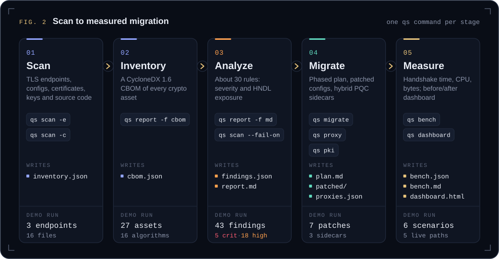
</picture>

| Stage | Command | Output |
|---|---|---|
| **Scan TLS endpoints**: protocol versions, negotiated cipher / key-exchange group / signature, every TLS 1.3 group accepted (including `X25519MLKEM768`, `SecP256r1MLKEM768`, `SecP384r1MLKEM1024`, `MLKEM768`), TLS 1.2 suites, certificate chain, whether mTLS is enforced | `qs scan -e name=host:port` | `inventory.json` |
| **Scan configuration**: nginx, Apache, HAProxy, Envoy, `openssl.cnf`, `sshd_config`, PEM certificates and private keys (incl. ML-DSA / ML-KEM keys), plus Python/Go/Java/JS source patterns | `qs scan -c path` | `inventory.json` |
| **Inventory** as a CycloneDX 1.6 CBOM (algorithms, certificates, protocols, keys, services and their dependencies); validated against the official schema in the tests | (written by `scan`) | `cbom.json` |
| **Identify vulnerabilities**: about 30 rules, each tagged with severity and whether it is exposed to *harvest-now-decrypt-later* (HNDL) | (written by `scan`) | `findings.json`, `report.md` |
| **Plan / perform migration**: phased plan per service, patched configs (nginx, Apache, HAProxy, OpenSSL, OpenSSH) with diffs, and sidecar-proxy definitions | `qs migrate` | `plan.md`, `patched/`, `proxies.json` |
| **Hybrid PQC proxy**: TLS 1.3 + `X25519MLKEM768`, ML-DSA workload certificates, mutual TLS with SPIFFE IDs, allow-lists, revocation, hot key rotation, `/stats` | `qs proxy` | running sidecar |
| **Workload PKI**: CA and short-lived certificates (ML-DSA-44/65/87, ECDSA, RSA, Ed25519), revocation | `qs pki init / issue / revoke` | `pki/` |
| **Measure**: handshake time, client & server CPU, bytes on the wire, in-process and over real connections | `qs bench local / net` | `bench.json`, `bench.md` |
| **Dashboard**: self-contained HTML, before/after | `qs dashboard` | `dashboard.html` |

`qs migrate` orders every service's work into four phases. These are the steps it wrote for the
demo services ([full plan with diffs](docs/sample-output/migration-plan.md)):

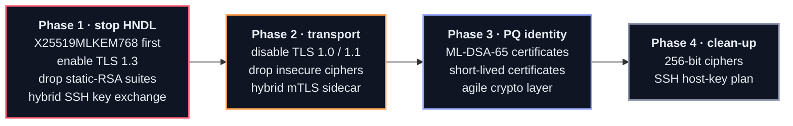

## Results

Everything below comes from one end-to-end run of the Docker demo on 2026-10-12: a 4-vCPU cloud
VM, OpenSSL 3.5.7, median of 200 handshakes, TLS 1.3 with mutual authentication; each side sends
its leaf certificate plus the issuing CA certificate. The raw output is in
[`docs/sample-output/`](docs/sample-output/) ([transcript](docs/sample-output/demo-transcript.txt),
[benchmarks](docs/sample-output/benchmarks.md), [inventory before](docs/sample-output/inventory-before.md)
and [after](docs/sample-output/inventory-after.md)).

### Three services, before and after the sidecars

<picture>
  <source media="(prefers-color-scheme: dark)" srcset="docs/assets/readiness.svg">
  <source media="(prefers-color-scheme: light)" srcset="docs/assets/readiness-light.svg">
  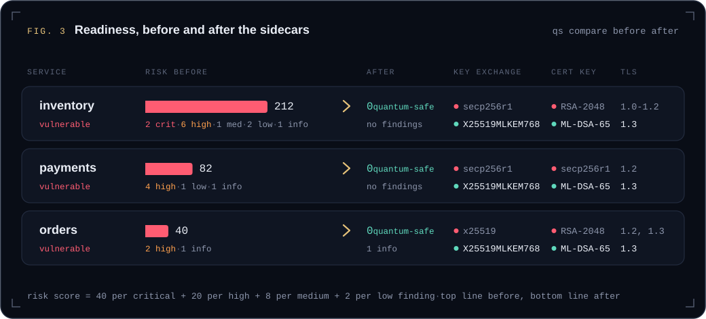
</picture>

| Service | Risk score | Key exchange | Certificate key | TLS | Mutual TLS | Findings |
|---|---:|---|---|---|---|---:|
| `inventory` | 212 → **0** | `secp256r1` → **`X25519MLKEM768`** | RSA-2048 → **ML-DSA-65** | 1.0–1.2 → **1.3** | no → **required** | 12 → **0** |
| `payments` | 82 → **0** | `secp256r1` → **`X25519MLKEM768`** | ECDSA P-256 → **ML-DSA-65** | 1.2 → **1.3** | no → **required** | 6 → **0** |
| `orders` | 40 → **0** | `x25519` → **`X25519MLKEM768`** | RSA-2048 → **ML-DSA-65** | 1.2, 1.3 → **1.3** | no → no (edge) | 3 → **1** |

Before: `inventory` had 2 critical, 6 high, 1 medium, 2 low and 1 info finding, `payments` 4 high,
1 low and 1 info, `orders` 2 high and 1 info. After, the one finding left is `QS-ZT-001` (info) on
`orders`: its public edge runs policy `prefer` without client certificates, by design.

The status of all three went from **vulnerable** to **quantum-safe** without touching the
services' code or certificates. The first scan covered more than the three endpoints: 43 findings
(5 critical, 18 high, 6 medium, 10 low, 4 info) across six services, including the sample
`legacy-configs`, `reports.internal` (Apache) and `legacy-pki`; `qs migrate` produced
7 config patches and 3 sidecar proxy definitions. The re-scan covers the three migrated endpoints.

The demo then exercises the zero-trust controls against the strict `payments` sidecar:

| Check | What happened |
|---|---|
| Classical-only client (`--groups X25519`) | refused: the strict sidecar offers only hybrid groups, the client sees an EOF |
| Valid ML-DSA certificate, identity not on the allow-list | `rejected … identity ['spiffe://quantumshield.local/intruder'] not in allow-list` |
| Key rotation: `payments` certificate re-issued while running | `context-reloaded`, next request served, no restart |
| Revoked certificate (`qs pki revoke`) | `rejected … certificate serial 1e3df50b… is revoked` |
| Legacy port `payments:443` from the network | `Connection refused` (nginx now listens on loopback only) |

### What the migration costs

<picture>
  <source media="(prefers-color-scheme: dark)" srcset="docs/assets/bench-handshake.svg">
  <source media="(prefers-color-scheme: light)" srcset="docs/assets/bench-handshake-light.svg">
  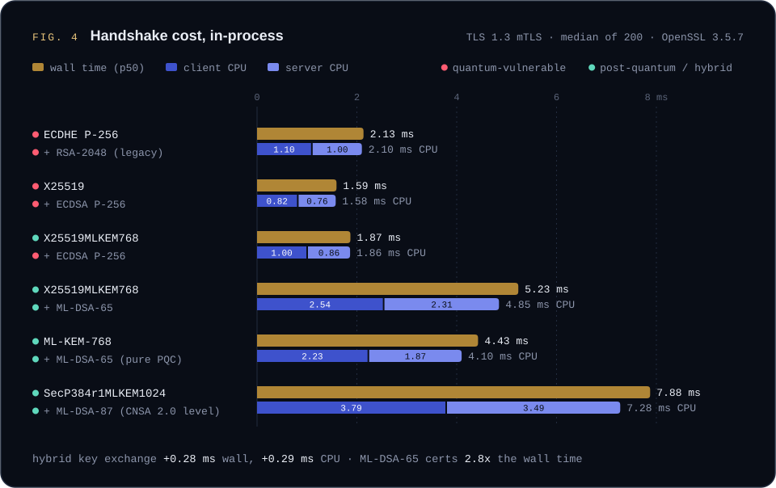
</picture>

<picture>
  <source media="(prefers-color-scheme: dark)" srcset="docs/assets/bench-bytes.svg">
  <source media="(prefers-color-scheme: light)" srcset="docs/assets/bench-bytes-light.svg">
  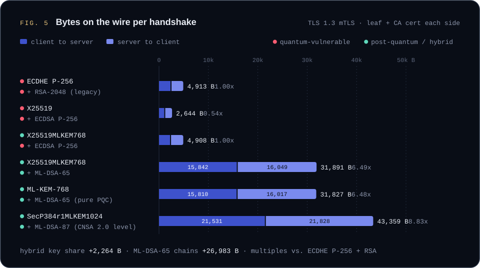
</picture>

<picture>
  <source media="(prefers-color-scheme: dark)" srcset="docs/assets/bench-network.svg">
  <source media="(prefers-color-scheme: light)" srcset="docs/assets/bench-network-light.svg">
  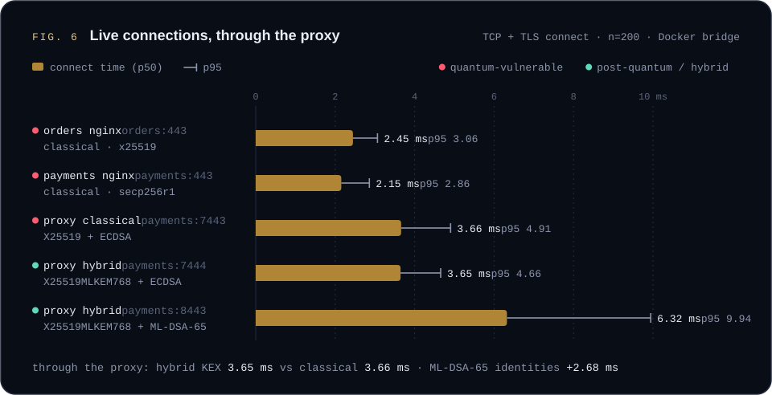
</picture>

**What the numbers say**

* **Hybrid key exchange is nearly free.** Going from `X25519` to `X25519MLKEM768` (ECDSA P-256
  certificates in both cases) adds **0.28 ms** of wall time and **0.29 ms of CPU** per handshake
  (client +0.19 ms, server +0.10 ms) and **2,264 bytes**, almost all of it the bigger key shares:
  1,216 bytes from the client and 1,120 from the server instead of X25519's 32 each. There is no
  extra round trip. Over a real connection through the proxy the two are indistinguishable:
  **3.65 ms** hybrid against **3.66 ms** classical (p50). This is the part that stops
  harvest-now-decrypt-later, so it is deployed first.
* **Post-quantum signatures are the expensive part.** With the same hybrid key exchange, swapping
  ECDSA P-256 certificates for ML-DSA-65 takes a handshake from 4,908 to **31,891 bytes** (6.5x)
  and from 1.87 to **5.23 ms** (2.8x); CPU goes from 1.86 to 4.85 ms, about 3x the classical
  1.58 ms. ML-DSA-65 public keys (1,952 B) and signatures (3,309 B) make each certificate about
  5.6 KB, and mutual TLS sends a two-certificate chain each way. Live, the ML-DSA hop costs
  6.32 ms p50 and 26,601 bytes. That is acceptable for long-lived service-to-service connections
  but worth planning for on constrained links, which is why the migration plan puts
  authentication in phase 3.
* **Dropping X25519 saves almost nothing.** Pure `MLKEM768` with ML-DSA-65 is 31,827 bytes, only
  64 bytes (two 32-byte X25519 shares) less than the hybrid; the hybrid keeps a classical
  safety net in case ML-KEM is ever broken.
* **The CNSA 2.0 level** (`SecP384r1MLKEM1024` + ML-DSA-87) costs 7.88 ms and 43,359 bytes,
  8.83x the bytes of a typical legacy ECDHE + RSA-2048 handshake.
* The Python proxy adds about **1.5 ms** over nginx on the same host (`payments`: 2.15 ms direct,
  3.66 ms through the proxy, classical in both cases). That is asyncio overhead, a fixed cost that
  does not depend on the algorithm.

<details>
<summary><b>Benchmark tables</b> (exact values from <code>bench.json</code>)</summary>

#### Handshake cost, in-process (TLS 1.3, mutual TLS, n = 200)

| Scenario | Group | Wall ms (p50) | Client CPU ms | Server CPU ms | Client → server B | Server → client B | Total B |
|---|---|---:|---:|---:|---:|---:|---:|
| ECDHE P-256 + RSA-2048 (legacy) | `secp256r1` | 2.132 | 1.098 | 1.003 | 2,430 | 2,483 | 4,913 |
| X25519 + ECDSA P-256 | `x25519` | 1.592 | 0.817 | 0.759 | 1,162 | 1,482 | 2,644 |
| **X25519MLKEM768** + ECDSA P-256 | `X25519MLKEM768` | 1.871 | 1.004 | 0.860 | 2,339 | 2,569 | 4,908 |
| **X25519MLKEM768 + ML-DSA-65** | `X25519MLKEM768` | 5.234 | 2.536 | 2.311 | 15,842 | 16,049 | 31,891 |
| ML-KEM-768 + ML-DSA-65 (pure PQC) | `MLKEM768` | 4.427 | 2.230 | 1.868 | 15,810 | 16,017 | 31,827 |
| SecP384r1MLKEM1024 + ML-DSA-87 (CNSA 2.0 level) | `SecP384r1MLKEM1024` | 7.876 | 3.790 | 3.486 | 21,531 | 21,828 | 43,359 |

#### Live connections, TCP + TLS (Docker bridge, n = 200)

| Path | Group | Connect ms (p50) | p95 | TLS ms | Client CPU ms | Proxy CPU ms/conn | Total B |
|---|---|---:|---:|---:|---:|---:|---:|
| orders nginx (classical) | `x25519` | 2.447 | 3.064 | 1.586 | 1.411 | – | 3,112 |
| payments nginx (classical) | `secp256r1` | 2.154 | 2.860 | 1.619 | 1.287 | – | 2,912 |
| proxy classical: X25519 + ECDSA | `x25519` | 3.660 | 4.905 | 3.042 | 1.446 | 3.506 | 2,695 |
| proxy hybrid: X25519MLKEM768 + ECDSA | `X25519MLKEM768` | 3.645 | 4.656 | 3.131 | 1.399 | 3.478 | 4,733 |
| proxy hybrid: X25519MLKEM768 + ML-DSA-65 | `X25519MLKEM768` | 6.324 | 9.944 | 5.835 | 2.533 | 5.351 | 26,601 |

The charts are drawn to scale from this file by
[`scripts/readme_charts.py`](scripts/readme_charts.py); rerun it after a new benchmark.

</details>

## How it works

<picture>
  <source media="(prefers-color-scheme: dark)" srcset="docs/assets/architecture.svg">
  <source media="(prefers-color-scheme: light)" srcset="docs/assets/architecture-light.svg">
  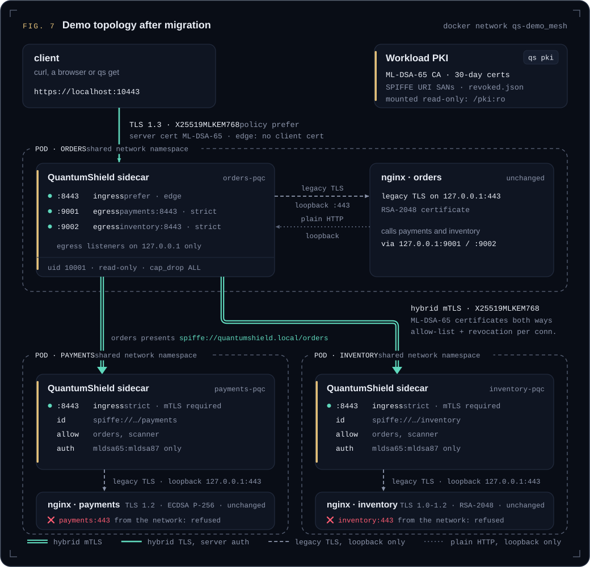
</picture>

A QuantumShield sidecar joins each service's network namespace (like a pod sidecar). It
terminates `X25519MLKEM768` + ML-DSA-65 mutual TLS on `:8443`, the service's own TLS moves to
loopback, and `orders`' outbound calls go through its egress sidecar. The services' code and
certificates are untouched. One hop, `orders` → `payments`:

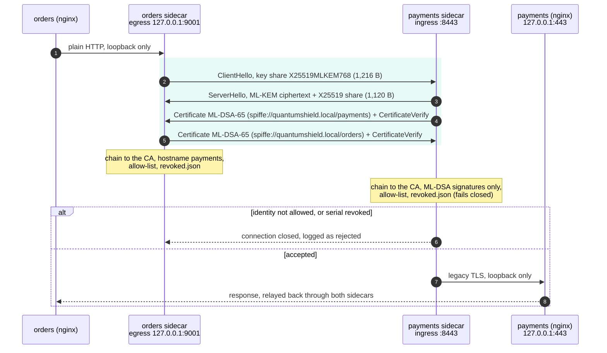

Run the same pair by hand:

```bash
qs pki init --dir pki --alg mldsa65
qs pki issue orders payments --dir pki --alg mldsa65 --days 30
# next to payments:
qs proxy --mode ingress --listen 0.0.0.0:8443 --upstream 127.0.0.1:8080 \
         --cert pki/payments.crt --key pki/payments.key --ca pki/ca.crt \
         --allow-id spiffe://quantumshield.local/orders --pq-auth --admin 127.0.0.1:9900
# next to orders:
qs proxy --mode egress --listen 127.0.0.1:9001 --upstream payments:8443 --server-name payments \
         --cert pki/orders.crt --key pki/orders.key --ca pki/ca.crt \
         --allow-id spiffe://quantumshield.local/payments --pq-auth
```

* **Policies**: `strict` offers and accepts only hybrid ML-KEM groups (use it for internal
  traffic). `prefer` puts hybrid first with classical fallback (use it at the edge, for clients
  you don't control). `classical` exists for baseline benchmarks. `--groups` takes any OpenSSL
  group list. This is the crypto-agility knob: changing algorithms is a config change, not a code
  change.
* **Workload identity**: certificates carry `spiffe://<trust-domain>/<name>` URI SANs. Ingress
  requires a client certificate by default; `--allow-id` restricts which identities may connect,
  and `--pq-auth` accepts only ML-DSA signatures, so a peer holding an RSA or ECDSA certificate
  cannot authenticate at all.
* **Rotation**: cert, key, CA and revocation files are content-hashed once per second, and new
  connections use the new material with no restart. Re-run `qs pki issue` to rotate.
* **Revocation**: `qs pki revoke cert.crt` adds the serial to `revoked.json` next to the CA;
  proxies reject it on the next connection.
* **Observability**: a JSON line per handshake (group, signature algorithm, peer identity,
  latency), and `GET /stats` on the admin port (CPU seconds, groups, failures, bytes).
* Config files hold one or more proxies: see [`demo/sidecars/*.json`](demo/sidecars/) and the
  `proxies.json` that `qs migrate` writes.

## Screenshots

<table>
  <tr>
    <td colspan="2"><a href="https://quantumshield.vercel.app">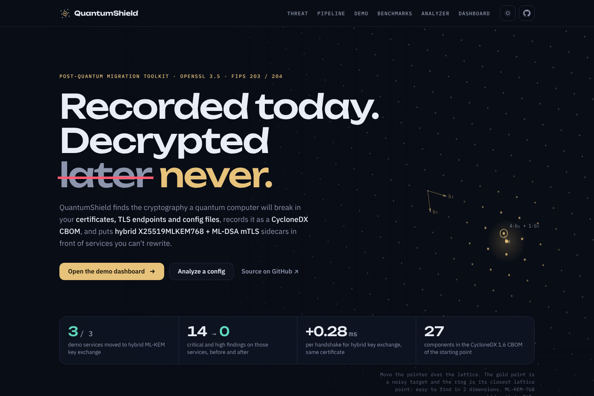</a><br><sub><b>Live site</b>: the threat, the pipeline and the demo results.</sub></td>
  </tr>
  <tr>
    <td width="50%"><a href="https://quantumshield.vercel.app/dashboard">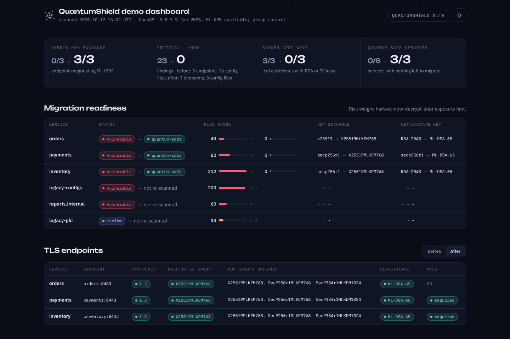</a><br><sub><b>Dashboard</b>: the self-contained before/after report from <code>qs dashboard</code>.</sub></td>
    <td width="50%"><a href="https://quantumshield.vercel.app/#analyzer">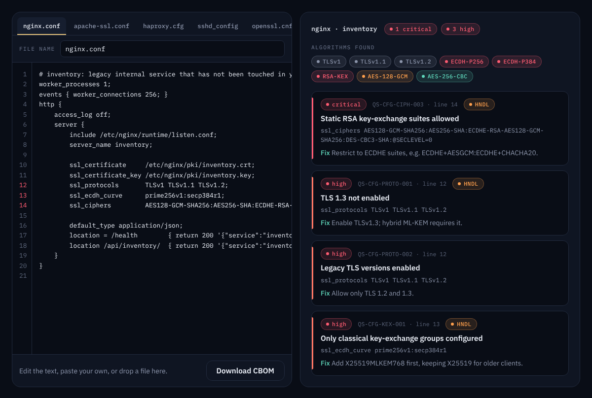</a><br><sub><b>Analyzer</b>: try the analysis in the browser.</sub></td>
  </tr>
</table>

## Quickstart

### The three-service demo (Docker)

```bash
git clone https://github.com/harshh-2505/quantumshield.git && cd quantumshield/demo
./run-demo.sh          # a few minutes; QS_BENCH_ITERATIONS=50 for a faster run
open out/dashboard.html
./run-demo.sh down
```

The demo runs three nginx services (`orders`, `payments`, `inventory`) configured the way real
legacy services are: RSA/ECDSA certificates, classical ECDHE, one TLS-1.2-only service and one
that still accepts TLS 1.0 and static-RSA key exchange. `orders` calls the other two over TLS.
Then QuantumShield:

1. **Scans** their certificates, TLS endpoints and config files (plus sample `sshd_config`,
   `openssl.cnf`, HAProxy, Apache and Python files in `demo/legacy-configs/`).
2. **Displays the cryptographic inventory** (CycloneDX CBOM + Markdown report).
3. **Identifies services requiring migration** and writes the plan and patched configs.
4. **Establishes hybrid post-quantum connections** with a sidecar per service (above).
5. **Compares connection time, CPU use and message size**, classical against hybrid.
6. Exercises the **zero-trust controls**: a classical-only client is refused, an unknown
   workload identity is refused, a rotated certificate is picked up without a restart, and a
   revoked certificate is refused.
7. **Re-scans** and renders the before/after dashboard.

### Without Docker

`demo/local/run-local.sh` runs the same flow with three small Python HTTPS services on
localhost. It needs **Python 3.15+ linked against OpenSSL 3.5+** (for example Python 3.15 built
on Debian trixie, whose system OpenSSL is 3.5) and the OpenSSL 3.5 CLI:

```bash
pip install -e '.[test]'
demo/local/run-local.sh
```

On older runtimes the scanner, config analysis, CBOM, migration planner and dashboard all still
work; only PQC group probing, the strict-PQC proxy and the PQC benchmarks need OpenSSL 3.5
(`qs info` reports what your runtime can do).

### On your own services

```bash
pip install -e .
qs info                                              # can this runtime do ML-KEM?
qs scan -e api=api.internal:443 -c api=/etc/nginx -o qs-out --fail-on high   # exit 1 on high: a CI gate
qs report qs-out/inventory.json -f md                # or -f cbom for the CycloneDX 1.6 CBOM
qs migrate qs-out/inventory.json -o qs-migration     # plan.md, patched/, proxies.json
qs bench local -n 200 -o bench.json                  # classical vs hybrid on this machine
qs dashboard --before qs-out/inventory.json --bench bench.json --plan qs-migration/plan.json \
             -o dashboard.html --serve 8000          # served on 127.0.0.1 only
```

## Security model

The proxy refuses unsafe configurations before it listens, fails closed on revocation, keeps
serving on a broken rotation, and the demo runs it unprivileged.

<details>
<summary><b>Security model in detail</b></summary>

**Validated at start-up.** Every proxy definition is checked before anything listens
(`ProxyConfig.validate`); `qs proxy` exits with a configuration error instead of running unsafely:

| Refused | Why |
|---|---|
| egress without `ca` | the remote must be verified with a CA (plus the hostname); `insecure_skip_verify` exists for lab use only, on egress only, and logs a warning |
| ingress without `cert` / `key` | an ingress terminates TLS, so it needs a server certificate |
| `require_client_cert` without `ca` | client certificates cannot be verified without a CA |
| `upstream_tls` without `upstream_ca` to a non-loopback upstream | unverified legacy TLS is allowed only to a loopback upstream |
| a private key readable by group or other | keys must be `chmod 600` |
| unknown config keys, duplicate `listen` addresses | a typo such as `requre_client_cert` must not silently fall back to a default |
| bad `name`, `mode`, `policy`, `host:port` or `max_connections` | |

Warnings are logged (not fatal) for an empty `allowed_ids` (any certificate from the CA is
accepted), an egress listener that is not on loopback (other hosts could use this workload's
identity), and the `classical` policy (no protection against harvest-now-decrypt-later).

**At run time**

* **Post-quantum-only authentication**: `sigalgs` restricts signature algorithms on both sides;
  `--pq-auth` sets it to ML-DSA only (`mldsa65:mldsa87:mldsa44`). The demo sidecars use
  `mldsa65:mldsa87`.
* **Every connection is fully re-authorised**: session tickets are disabled, so no connection
  skips the identity, revocation and policy checks by resuming a session.
* **Revocation fails closed**: if `revoked.json` exists but cannot be read or parsed, every peer
  is rejected until it is fixed.
* **A broken rotation keeps serving the previous certificate**: if a half-written cert/key pair
  fails to load, the proxy keeps the old material, counts a reload failure and retries.
* **Bounded resources**: `max_connections` (default 1024), handshake and connect timeouts
  (10 s each) and an idle timeout (300 s).
* **Admin endpoint**: off unless `--admin` is given, intended for loopback (the proxy warns when it
  is reachable from the network); it answers `GET /healthz` and `/stats` only, with a bounded
  request (2 KB request line, 100 headers, 5 s). The Docker demo binds it inside each pod so the
  benchmark can read proxy CPU.

**Containers.** The image runs as an unprivileged user (uid 10001). The sidecars in
[`demo/docker-compose.yml`](demo/docker-compose.yml) run as that user with a read-only root
filesystem, all capabilities dropped, `no-new-privileges`, and the PKI mounted read-only. (The
demo's one-shot `qs` tool container runs as root so it can write PKI and reports into the bind
mount.)

**PKI.** `qs pki` creates keys under umask 077 and `chmod 600`, writes new keys and certificates
next to the old ones and swaps them in atomically (a hot-reloading proxy never sees a truncated
file), replaces `revoked.json` atomically, validates workload names, trust domains and DNS names,
limits lifetimes to 1–825 days, and only revokes certificates issued by that CA.

**Dashboard.** `qs dashboard --serve` binds `127.0.0.1` unless `--bind` says otherwise.

**Tests.** 41 tests pass in the image, including
[`tests/test_proxy_config.py`](tests/test_proxy_config.py) (configuration validation) and the
hardening tests at the end of [`tests/test_pqc_integration.py`](tests/test_pqc_integration.py):
ML-DSA-only signature algorithms refuse an ECDSA client, an unreadable revocation list fails
closed, a broken rotation keeps serving, the connection cap and idle timeout hold, and an unsafe
config is refused at start.

</details>

## Reference

<details>
<summary><b>CLI reference</b></summary>

```
qs info                                    TLS runtime capabilities (ML-KEM? group control?)
qs scan  -e [name=]host:port ... -c [service=]path ... [--targets-file F]
         [--client-cert C --client-key K] [-o qs-out] [--fail-on high]
                                           inventory.json, cbom.json, findings.json, report.md, dashboard.html
qs report inventory.json [-f text|md|cbom]
qs migrate inventory.json [-o qs-migration] [--in-place]
                                           plan.md, plan.json, patched/, proxies.json
qs compare before/inventory.json after/inventory.json
qs pki init   [--dir pki] [--alg mldsa65] [--name "QuantumShield Root CA"]
qs pki issue  NAME ... [--dir pki] [--alg mldsa65] [--days 30] [--dns NAME] [--trust-domain quantumshield.local]
qs pki revoke CERT [--dir pki]
qs proxy --config proxies.json [--admin host:port] [--log-level INFO]
qs proxy --mode ingress|egress --listen H:P --upstream H:P [--name N]
         [--policy strict|prefer|classical] [--groups LIST]
         [--cert C --key K] [--ca CA] [--allow-id spiffe://...] [--no-client-auth]
         [--server-name N] [--upstream-tls [--upstream-ca CA]]
         [--pq-auth | --sigalgs mldsa65:mldsa87] [--max-connections 1024] [--idle-timeout 300]
         [--insecure-skip-verify] [--admin host:port]
qs get https://host:port/path [--groups X25519] [--cert C --key K] [--ca CA] [-k]
                                           a PQC-aware curl: prints group, signature, peer identity
qs bench local [-n 200] [--no-mtls] [--scenarios a,b] [-o bench.json [--merge]]
qs bench net -t 'name=host:port,group=X25519MLKEM768,cert=..,key=..,admin=http://..' [-n 100]
         [-o bench.json [--merge]]
qs dashboard --before inv.json [--after inv.json] [--bench bench.json] [--plan plan.json]
         [-o dashboard.html] [--serve PORT [--bind 127.0.0.1]]
```

`--fail-on high` makes `qs scan` usable as a CI gate. Key algorithms for `qs pki`: `rsa2048`,
`rsa3072`, `ecdsa-p256`, `ecdsa-p384`, `ed25519`, `mldsa44`, `mldsa65`, `mldsa87`. Benchmark
scenarios: `classical-rsa`, `classical-ecdsa`, `hybrid-ecdsa`, `hybrid-mldsa`, `pqc-only`,
`hybrid-high`. `quantumshield` is the long name of `qs`.

</details>

<details>
<summary><b>Proxy configuration</b> (<code>proxies.json</code>)</summary>

A file holds `{"proxies": [ ... ]}`, a list, or a single object. Relative `cert`, `key`, `ca`,
`upstream_ca` and `revocation_list` paths resolve against the file's directory. Unknown keys are
an error.

| Key | Default | Meaning |
|---|---|---|
| `name` | required | 1–64 letters, digits, `_ . : -`; used in logs and `/stats` |
| `mode` | required | `ingress`: TLS listener → local upstream; `egress`: local plain listener → remote ingress |
| `listen` | required | `host:port`; unique within the file |
| `upstream` | required | `host:port` to forward to |
| `policy` | `"strict"` | `strict`: hybrid ML-KEM groups only; `prefer`: hybrid first, classical fallback; `classical`: baseline benchmarks only |
| `groups` | `null` | explicit OpenSSL group list; overrides `policy` |
| `sigalgs` | `null` | allowed signature algorithms, e.g. `"mldsa65:mldsa87"` for post-quantum authentication only |
| `cert`, `key` | `null` | this workload's certificate and private key (given together; key `chmod 600`); required for ingress |
| `ca` | `null` | CA used to verify peers; required for egress and for `require_client_cert` |
| `require_client_cert` | `true` | ingress: demand a client certificate (mutual TLS) |
| `allowed_ids` | `[]` | peer SPIFFE IDs (URI SANs) to accept; empty accepts any certificate from the CA |
| `server_name` | `null` | egress: name the remote certificate must match; defaults to the upstream host |
| `upstream_tls` | `false` | ingress: the upstream itself speaks (legacy) TLS |
| `upstream_ca` | `null` | ingress: verify that legacy upstream with this CA; without it the upstream must be loopback |
| `revocation_list` | `null` | JSON list of revoked serials; defaults to `revoked.json` next to `ca`; fails closed if unreadable |
| `max_connections` | `1024` | concurrent connections; extra ones are closed and counted |
| `handshake_timeout` | `10.0` | seconds |
| `connect_timeout` | `10.0` | seconds to reach the upstream |
| `idle_timeout` | `300.0` | close a relayed connection idle this long; `0` = never |
| `insecure_skip_verify` | `false` | egress only, lab use: do not authenticate the remote |

Policy group lists: `strict` = `X25519MLKEM768:SecP256r1MLKEM768:SecP384r1MLKEM1024`;
`prefer` = `*X25519MLKEM768:*X25519:SecP256r1MLKEM768:secp256r1:SecP384r1MLKEM1024:secp384r1`
(key shares for the starred groups go out up front, so classical-only peers still finish in one
round trip); `classical` = `X25519:secp256r1:secp384r1`.

The `payments` sidecar from the demo ([`demo/sidecars/payments.json`](demo/sidecars/payments.json)):

```json
{
  "name": "payments-ingress",
  "mode": "ingress",
  "listen": "0.0.0.0:8443",
  "upstream": "127.0.0.1:443",
  "upstream_tls": true,
  "policy": "strict",
  "require_client_cert": true,
  "cert": "/pki/pqc/payments.crt",
  "key": "/pki/pqc/payments.key",
  "ca": "/pki/pqc/ca.crt",
  "allowed_ids": ["spiffe://quantumshield.local/orders", "spiffe://quantumshield.local/scanner"],
  "sigalgs": "mldsa65:mldsa87"
}
```

</details>

<details>
<summary><b>CBOM sample</b> (CycloneDX 1.6)</summary>

An excerpt of [`docs/sample-output/cbom-after.json`](docs/sample-output/cbom-after.json): the
hybrid group, the ML-DSA-65 algorithm, the `payments` certificate and its TLS endpoint, as the
re-scan recorded them.

```json
{
  "bomFormat": "CycloneDX",
  "specVersion": "1.6",
  "metadata": {
    "timestamp": "2026-10-12T16:02:52+00:00",
    "tools": { "components": [{ "type": "application", "name": "quantumshield", "version": "0.1.0" }] },
    "properties": [{ "name": "quantumshield:tls-library",
                     "value": "OpenSSL 3.5.7 9 Jun 2026; ML-KEM available; group control" }]
  },
  "components": [
    {
      "type": "cryptographic-asset",
      "bom-ref": "crypto/algorithm/X25519MLKEM768",
      "name": "X25519MLKEM768",
      "cryptoProperties": {
        "assetType": "algorithm",
        "algorithmProperties": {
          "primitive": "combiner",
          "parameterSetIdentifier": "X25519MLKEM768",
          "executionEnvironment": "software-plain-ram",
          "cryptoFunctions": ["encapsulate", "decapsulate", "keygen"],
          "classicalSecurityLevel": 128,
          "nistQuantumSecurityLevel": 3
        }
      },
      "properties": [{ "name": "quantumshield:quantum-status", "value": "hybrid" }]
    },
    {
      "type": "cryptographic-asset",
      "bom-ref": "crypto/algorithm/ML-DSA-65",
      "name": "ML-DSA-65",
      "cryptoProperties": {
        "assetType": "algorithm",
        "algorithmProperties": {
          "primitive": "signature",
          "parameterSetIdentifier": "ML-DSA-65",
          "executionEnvironment": "software-plain-ram",
          "cryptoFunctions": ["sign", "verify", "keygen"],
          "classicalSecurityLevel": 192,
          "nistQuantumSecurityLevel": 3
        },
        "oid": "2.16.840.1.101.3.4.3.18"
      },
      "properties": [{ "name": "quantumshield:quantum-status", "value": "quantum-resistant" }]
    },
    {
      "type": "cryptographic-asset",
      "bom-ref": "crypto/certificate/d5a87536bf867d7c",
      "name": "CN=payments,O=QuantumShield",
      "cryptoProperties": {
        "assetType": "certificate",
        "certificateProperties": {
          "subjectName": "CN=payments,O=QuantumShield",
          "issuerName": "CN=QuantumShield Root CA,O=QuantumShield",
          "notValidBefore": "2026-10-12T16:02:48+00:00",
          "notValidAfter": "2026-11-11T16:02:48+00:00",
          "signatureAlgorithmRef": "crypto/algorithm/ML-DSA-65",
          "subjectPublicKeyRef": "crypto/algorithm/ML-DSA-65",
          "certificateFormat": "X.509",
          "certificateExtension": "crt"
        }
      },
      "properties": [
        { "name": "quantumshield:san", "value": "URI:spiffe://quantumshield.local/payments" },
        { "name": "quantumshield:source", "value": "tls://payments:8443" }
      ]
    },
    {
      "type": "cryptographic-asset",
      "bom-ref": "crypto/protocol/tls/payments:8443",
      "name": "TLS @ payments:8443",
      "cryptoProperties": {
        "assetType": "protocol",
        "protocolProperties": {
          "type": "tls",
          "version": "1.3",
          "cipherSuites": [{ "name": "TLS_AES_256_GCM_SHA384",
                             "algorithms": ["crypto/algorithm/AES-256-GCM"] }]
        }
      },
      "properties": [
        { "name": "quantumshield:negotiated-group", "value": "X25519MLKEM768" },
        { "name": "quantumshield:pqc-groups",
          "value": "X25519MLKEM768, SecP256r1MLKEM768, SecP384r1MLKEM1024" },
        { "name": "quantumshield:mtls-required", "value": "true" }
      ]
    }
  ],
  "services": [{ "bom-ref": "service/payments", "name": "payments", "endpoints": ["tls://payments:8443"] }],
  "dependencies": [{ "ref": "service/payments", "dependsOn": ["crypto/protocol/tls/payments:8443"] }]
}
```

</details>

<details>
<summary><b>Detection rules</b></summary>

| Rule | Severity | HNDL | Meaning |
|---|---|---|---|
| QS-TLS-KEX-001 / QS-CFG-KEX-001 | high | yes | Only classical key exchange (ECDHE, X25519, FFDHE) is negotiated / configured |
| QS-TLS-KEX-002 | medium | yes | Server supports hybrid groups but prefers classical |
| QS-TLS-KEX-003 / QS-CFG-CIPH-003 | critical | yes | Static-RSA key exchange (no forward secrecy) |
| QS-TLS-PROTO-001 / QS-CFG-PROTO-001 | high | yes | No TLS 1.3, so hybrid ML-KEM is impossible |
| QS-TLS-PROTO-002 / QS-CFG-PROTO-002 | high | | TLS 1.0 / 1.1 accepted |
| QS-TLS-PROTO-003 | low | | TLS 1.2 fallback lets clients bypass PQC key exchange |
| QS-TLS-CIPH-001 / QS-CFG-CIPH-001 | high | | 3DES / RC4 / DES / MD5 |
| QS-TLS-CIPH-002 | low | | 128-bit cipher preferred (Grover) |
| QS-CERT-SIG-001 | medium | | RSA / ECDSA / EdDSA certificate key: plan ML-DSA |
| QS-CERT-KEY-001, QS-CERT-HASH-001 | high | | RSA < 2048, SHA-1/MD5 signature |
| QS-CERT-EXP-001/002, QS-CERT-ROT-001, QS-CERT-TRUST-001 | high…low | | Expired, expiring, long-lived, self-signed |
| QS-SSH-KEX-001/002 | high | yes | SSH without `mlkem768x25519-sha256` / `sntrup761x25519`; SHA-1 DH |
| QS-SSH-HK-001/002, QS-SSH-CIPH-001 | low…high | | SSH host keys and ciphers |
| QS-KEY-001 | low | | Quantum-vulnerable private key on disk |
| QS-CODE-001/002/003 | medium…high | | Hard-coded RSA/ECC, MD5/SHA-1, 3DES/RC4/TLS 1.0 in source |
| QS-ZT-001 | info | | Endpoint does not require mutual TLS |

The risk score per service is 40 per critical, 20 per high, 8 per medium and 2 per low finding.

</details>

<details>
<summary><b>Project layout</b></summary>

```
quantumshield/
├── quantumshield/              the package; CLI `quantumshield` / `qs`
│   ├── catalog.py              algorithm knowledge base (quantum status, NIST level, OIDs, replacements)
│   ├── tls_scanner.py          active endpoint scanner
│   ├── config_scanner.py       static config / key / source scanner
│   ├── certs.py                certificate parsing + PKI via the openssl CLI
│   ├── analyzer.py             rules, readiness and risk score per service
│   ├── cbom.py                 CycloneDX 1.6 CBOM
│   ├── migrate.py              plan, config patchers, sidecar definitions
│   ├── proxy.py                hybrid PQC mTLS proxy
│   ├── tlsutil.py              TLS 1.3 group and signature-algorithm control
│   ├── bench.py                handshake + live benchmarks
│   ├── dashboard.py            self-contained HTML dashboard (template: dashboard.html)
│   ├── report.py               text and Markdown reports
│   ├── models.py               inventory data model
│   └── cli.py                  command line
├── demo/
│   ├── run-demo.sh             Docker demo, end to end
│   ├── docker-compose.yml      three nginx services, three sidecars, the qs tool container
│   ├── services/               nginx configs: classical and post-migration listeners
│   ├── sidecars/               one proxy config per sidecar
│   ├── legacy-configs/         sample sshd_config, openssl.cnf, HAProxy, Apache, Python
│   └── local/                  Docker-free demo (Python services)
├── tests/                      unit tests (any Python ≥ 3.11) + PQC integration tests (Python 3.15 / OpenSSL 3.5)
│   └── schemas/                CycloneDX 1.6 JSON schemas the CBOM is validated against
├── docs/
│   ├── sample-output/          inventory, CBOMs, plan, benchmarks, transcript and dashboard from a demo run
│   └── assets/                 README artwork (SVG) and screenshots
├── scripts/
│   ├── readme_charts.py        redraws the README benchmark charts from bench.json
│   ├── build_web.py            builds the website in web/ from the demo results
│   └── gen_cipher_table.py     OpenSSL cipher-string table for the in-browser analyzer
├── web/                        static website (quantumshield.vercel.app), design tokens, fonts
├── Dockerfile                  Python 3.15 on Debian trixie (OpenSSL 3.5), non-root user
└── pyproject.toml
```

</details>

## Tests

```bash
pip install -e '.[test]' && pytest                    # unit tests; PQC tests skip on older runtimes
docker build -t quantumshield . && docker run --rm --entrypoint pytest quantumshield -q   # everything
```

CI runs the unit tests on Python 3.11 and 3.13, then builds the image and runs the full suite
plus a short `qs bench local` inside it.

## Limitations and notes

* The image uses `python:3.15-rc-slim-trixie` because Python 3.15 is the first release that
  exposes `SSLContext.set_groups()` and `SSLSocket.group()`. Switch the `BASE_IMAGE` build arg to
  `python:3.15-slim-trixie` once 3.15.0 final is published.
* Certificates are pure ML-DSA. Composite (ML-DSA + ECDSA) certificates are not yet supported by
  OpenSSL 3.5; when they are, `qs pki` only needs a new key-algorithm entry.
* When the asyncio-based proxy refuses a handshake it closes the connection rather than sending a
  TLS alert, so refused clients report an EOF.
* The scanner sees what a server *offers*. Algorithms used only after authentication, or inside
  application payloads, need the config and source scanners or manual review.
* Benchmarks include each side's issuing CA certificate in the chain (OpenSSL's automatic chain
  building), which matches a typical leaf + intermediate deployment.

## References

* NIST [FIPS 203: ML-KEM](https://csrc.nist.gov/pubs/fips/203/final),
  [FIPS 204: ML-DSA](https://csrc.nist.gov/pubs/fips/204/final),
  [FIPS 205: SLH-DSA](https://csrc.nist.gov/pubs/fips/205/final) (August 2024)
* [NIST IR 8547: Transition to Post-Quantum Cryptography Standards](https://csrc.nist.gov/pubs/ir/8547/ipd)
* [draft-ietf-tls-ecdhe-mlkem](https://datatracker.ietf.org/doc/draft-ietf-tls-ecdhe-mlkem/):
  `X25519MLKEM768` (0x11EC), `SecP256r1MLKEM768`, `SecP384r1MLKEM1024` for TLS 1.3
* [CycloneDX CBOM](https://cyclonedx.org/capabilities/cbom/) (CycloneDX 1.6)
* [OpenSSL 3.5 release notes](https://openssl-library.org/news/openssl-3.5-notes/)
* [NIST Post-Quantum Cryptography project](https://csrc.nist.gov/projects/post-quantum-cryptography)
* M. Mosca, [Cybersecurity in an era with quantum computers: will we be ready?](https://eprint.iacr.org/2015/1075)
  (the x + y > z inequality)

## License

Apache-2.0, see [LICENSE](LICENSE). The README artwork embeds subsets of IBM Plex Sans and
IBM Plex Mono and outlines of Unbounded, all under the SIL Open Font License 1.1
([`web/assets/fonts/`](web/assets/fonts/)).
