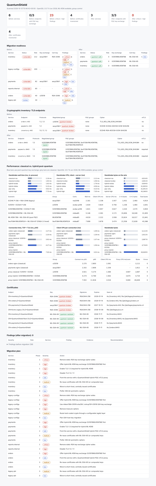

# QuantumShield

**Post-quantum crypto-agility toolkit.** QuantumShield finds where quantum-vulnerable
cryptography is used, records it as a Cryptographic Bill of Materials (CBOM), tells you
what to migrate first, and migrates services to hybrid post-quantum TLS with a sidecar
proxy, then measures what the migration costs.

No quantum computer is involved: ML-KEM (FIPS 203) and ML-DSA (FIPS 204) run on ordinary
CPUs. QuantumShield does **not** implement any cryptography itself. Key exchange,
signatures and certificate handling come from **OpenSSL 3.5** through Python's `ssl`
module and the `openssl` CLI; certificate parsing uses `cryptography`.

```
scan services & configs ─▶ CBOM inventory ─▶ findings & priorities ─▶ migrate ─▶ measure
   (qs scan)                (cbom.json)        (findings.json)         (qs migrate,   (qs bench,
                                                                        qs proxy)      qs dashboard)
```



## What it does

| Stage | Command | Output |
|---|---|---|
| **Scan TLS endpoints**: protocol versions, negotiated cipher / key-exchange group / signature, every TLS 1.3 group accepted (including `X25519MLKEM768`, `SecP256r1MLKEM768`, `SecP384r1MLKEM1024`, `MLKEM768`), TLS 1.2 suites, certificate chain, whether mTLS is enforced | `qs scan -e name=host:port` | `inventory.json` |
| **Scan configuration**: nginx, Apache, HAProxy, Envoy, `openssl.cnf`, `sshd_config`, PEM certificates and private keys (incl. ML-DSA / ML-KEM keys), plus Python/Go/Java/JS source patterns | `qs scan -c path` | `inventory.json` |
| **Inventory** as a CycloneDX 1.6 CBOM (algorithms, certificates, protocols, keys, services and their dependencies); validated against the official schema in the tests | (written by `scan`) | `cbom.json` |
| **Identify vulnerabilities**: about 30 rules, each tagged with severity and whether it is exposed to *harvest-now-decrypt-later* (HNDL) | (written by `scan`) | `findings.json`, `report.md` |
| **Plan / perform migration**: phased plan per service, patched configs (nginx, Apache, HAProxy, OpenSSL, OpenSSH) with diffs, and sidecar-proxy definitions | `qs migrate` | `plan.md`, `patched/`, `proxies.json` |
| **Hybrid PQC proxy**: TLS 1.3 + `X25519MLKEM768`, ML-DSA workload certificates, mutual TLS with SPIFFE IDs, allow-lists, revocation, hot key rotation, `/stats` | `qs proxy` | running sidecar |
| **Workload PKI**: CA and short-lived certificates (ML-DSA-44/65/87, ECDSA, RSA, Ed25519), revocation | `qs pki init / issue / revoke` | `pki/` |
| **Measure**: handshake time, client & server CPU, bytes on the wire, in-process and over real connections | `qs bench local / net` | `bench.json`, `bench.md` |
| **Dashboard**: self-contained HTML, before/after | `qs dashboard` | `dashboard.html` |

## Quick start: the three-service demo (Docker)

```bash
git clone <this repo> && cd quantumshield/demo
./run-demo.sh          # a few minutes; QS_BENCH_ITERATIONS=50 for a faster run
open out/dashboard.html
./run-demo.sh down
```

The demo runs three nginx services (`orders`, `payments`, `inventory`) configured the way
real legacy services are: RSA/ECDSA certificates, classical ECDHE, one TLS-1.2-only
service and one that still accepts TLS 1.0 and static-RSA key exchange. `orders` calls
the other two over TLS. Then QuantumShield:

1. **Scans** their certificates, TLS endpoints and config files (plus sample `sshd_config`,
   `openssl.cnf`, HAProxy, Apache and Python files in `demo/legacy-configs/`).
2. **Displays the cryptographic inventory** (CycloneDX CBOM + Markdown report).
3. **Identifies services requiring migration** and writes the plan and patched configs.
4. **Establishes hybrid post-quantum connections**: a QuantumShield sidecar joins each
   service's network namespace (like a pod sidecar). The sidecar terminates
   `X25519MLKEM768` + ML-DSA-65 mutual TLS on `:8443`, the service's own TLS moves to
   loopback, and `orders`' outbound calls go through its egress sidecar. The services'
   code and certificates are untouched.
5. **Compares connection time, CPU use and message size**, classical against hybrid.
6. Exercises the **zero-trust controls**: a classical-only client is refused, an unknown
   workload identity is refused, a rotated certificate is picked up without a restart,
   and a revoked certificate is refused.
7. **Re-scans** and renders the before/after dashboard.

Sample output from a full run is in [`docs/sample-output/`](docs/sample-output/).

### Without Docker

`demo/local/run-local.sh` runs the same flow with three small Python HTTPS services on
localhost. It needs **Python 3.15+ linked against OpenSSL 3.5+** (for example Python
3.15 built on Debian trixie, whose system OpenSSL is 3.5) and the OpenSSL 3.5 CLI:

```bash
pip install -e '.[test]'
demo/local/run-local.sh
```

On older runtimes the scanner, config analysis, CBOM, migration planner and dashboard all
still work; only PQC group probing, the strict-PQC proxy and the PQC benchmarks need
OpenSSL 3.5 (`qs info` reports what your runtime can do).

## Results from the demo

Measured on a 4-vCPU cloud VM, OpenSSL 3.5.7, median of 200 handshakes, TLS 1.3 with
mutual authentication; each side sends its leaf certificate plus the issuing CA
certificate. Full tables: [`docs/sample-output/benchmarks.md`](docs/sample-output/benchmarks.md).

| Handshake (in-process, no network) | Wall ms | Client CPU ms | Server CPU ms | Bytes on the wire |
|---|---:|---:|---:|---:|
| X25519 + ECDSA P-256 (classical) | 1.63 | 0.82 | 0.76 | 2,641 |
| ECDHE P-256 + RSA-2048 (typical legacy) | 2.16 | 1.11 | 1.01 | 4,914 |
| **X25519MLKEM768** + ECDSA P-256 | 1.82 | 0.96 | 0.83 | 4,904 |
| **X25519MLKEM768 + ML-DSA-65** | 5.15 | 2.39 | 2.17 | 31,905 |
| ML-KEM-768 + ML-DSA-65 (pure PQC) | 4.62 | 2.22 | 2.01 | 31,841 |
| SecP384r1MLKEM1024 + ML-DSA-87 | 7.70 | 3.88 | 3.47 | 43,386 |

| Live connection through the proxy (Docker bridge) | Connect ms p50 | Client CPU ms | Proxy CPU ms/conn | Bytes |
|---|---:|---:|---:|---:|
| classical: X25519 + ECDSA | 3.92 | 1.37 | 3.70 | 2,697 |
| hybrid KEM: X25519MLKEM768 + ECDSA | 4.27 | 1.56 | 3.87 | 4,734 |
| full PQC identity: X25519MLKEM768 + ML-DSA-65 | 7.00 | 3.02 | 5.69 | 26,649 |

What the numbers say:

* **Hybrid key exchange is nearly free.** Adding ML-KEM-768 to X25519 costs about 0.2 ms
  of CPU per handshake and about 2.3 KB (the 1,216-byte hybrid key share and the
  1,120-byte reply), with no extra round trip. This is the part that stops
  harvest-now-decrypt-later, so it should be deployed first.
* **Post-quantum signatures are the expensive part.** ML-DSA-65 public keys (1,952 B) and
  signatures (3,309 B) make each certificate about 5.6 KB, so a mutually authenticated
  handshake with two-certificate chains grows to about 32 KB, and CPU roughly triples.
  That is acceptable for long-lived service-to-service connections, but worth planning for
  on constrained links. This is why the migration plan puts authentication in phase 3.
* The Python proxy adds about 1.5 ms over nginx for the same classical handshake (asyncio
  overhead). That is a fixed cost and does not depend on the algorithm.

## The hybrid proxy

```
 orders ──plain──▶ orders sidecar (egress) ══ TLS 1.3, X25519MLKEM768, ML-DSA-65 mTLS ══▶ payments sidecar (ingress) ──▶ payments
                    127.0.0.1:9001             spiffe://…/orders ⇄ spiffe://…/payments      :8443, allow-list                 127.0.0.1:443
```

```bash
qs pki init --dir pki --alg mldsa65
qs pki issue orders payments --dir pki --alg mldsa65 --days 30
# next to payments:
qs proxy --mode ingress --listen 0.0.0.0:8443 --upstream 127.0.0.1:8080 \
         --cert pki/payments.crt --key pki/payments.key --ca pki/ca.crt \
         --allow-id spiffe://quantumshield.local/orders --admin 127.0.0.1:9900
# next to orders:
qs proxy --mode egress --listen 127.0.0.1:9001 --upstream payments:8443 --server-name payments \
         --cert pki/orders.crt --key pki/orders.key --ca pki/ca.crt \
         --allow-id spiffe://quantumshield.local/payments
```

* **Policies**: `strict` offers and accepts only hybrid ML-KEM groups (use it for internal
  traffic). `prefer` puts hybrid first with classical fallback (use it at the edge, for
  clients you don't control). `classical` exists for baseline benchmarks. `--groups`
  takes any OpenSSL group list. This is the crypto-agility knob: changing algorithms is a
  config change, not a code change.
* **Workload identity**: certificates carry `spiffe://<trust-domain>/<name>` URI SANs. Ingress
  requires a client certificate by default; `--allow-id` restricts which identities may connect.
* **Rotation**: cert, key, CA and revocation files are content-hashed once per second, and
  new connections use the new material with no restart. Re-run `qs pki issue` to rotate.
* **Revocation**: `qs pki revoke cert.crt` adds the serial to `revoked.json` next to the CA;
  proxies reject it on the next connection.
* **Observability**: a JSON line per handshake (group, signature algorithm, peer identity,
  latency), and `GET /stats` on the admin port (CPU seconds, groups, failures, bytes).
* Config files hold one or more proxies: see `demo/sidecars/*.json` and the `proxies.json`
  that `qs migrate` writes.

## CLI reference

```
qs info                                    TLS runtime capabilities (ML-KEM? group control?)
qs scan  -e [name=]host:port ... -c [service=]path ... [--client-cert C --client-key K]
         [-o qs-out] [--fail-on high]      inventory.json, cbom.json, findings.json, report.md, dashboard.html
qs report inventory.json [-f text|md|cbom]
qs migrate inventory.json [-o dir] [--in-place]
qs compare before/inventory.json after/inventory.json
qs pki init|issue|revoke ...
qs proxy --config proxies.json [--admin host:port] | --mode ingress|egress --listen --upstream ...
qs get https://host:port/path [--groups X25519] [--cert --key]   a PQC-aware curl
qs bench local [-n 200] [--no-mtls] [--scenarios a,b]
qs bench net -t 'name=host:port,group=X25519MLKEM768,cert=..,key=..,admin=http://..' [-n 100]
qs dashboard --before inv.json [--after inv.json] [--bench bench.json] [--plan plan.json]
```

`--fail-on high` makes `qs scan` usable as a CI gate.

## Rules

| Rule | Severity | HNDL | Meaning |
|---|---|---|---|
| QS-TLS-KEX-001 / QS-CFG-KEX-001 | high | yes | Only classical key exchange (ECDHE, X25519, FFDHE) is negotiated / configured |
| QS-TLS-KEX-002 | medium | yes | Server supports hybrid groups but prefers classical |
| QS-TLS-KEX-003 / QS-CFG-CIPH-003 | critical | yes | Static-RSA key exchange (no forward secrecy) |
| QS-TLS-PROTO-001 / QS-CFG-PROTO-001 | high | yes | No TLS 1.3, so hybrid ML-KEM is impossible |
| QS-TLS-PROTO-002 / QS-CFG-PROTO-002 | high | | TLS 1.0 / 1.1 accepted |
| QS-TLS-PROTO-003 | low | | TLS 1.2 fallback lets clients bypass PQC key exchange |
| QS-TLS-CIPH-001 / QS-CFG-CIPH-001 | high | | 3DES / RC4 / DES / MD5 |
| QS-TLS-CIPH-002 | low | | 128-bit cipher preferred (Grover) |
| QS-CERT-SIG-001 | medium | | RSA / ECDSA / EdDSA certificate key: plan ML-DSA |
| QS-CERT-KEY-001, QS-CERT-HASH-001 | high | | RSA < 2048, SHA-1/MD5 signature |
| QS-CERT-EXP-001/002, QS-CERT-ROT-001, QS-CERT-TRUST-001 | high…low | | Expired, expiring, long-lived, self-signed |
| QS-SSH-KEX-001/002 | high | yes | SSH without `mlkem768x25519-sha256` / `sntrup761x25519`; SHA-1 DH |
| QS-SSH-HK-001/002, QS-SSH-CIPH-001 | low…high | | SSH host keys and ciphers |
| QS-KEY-001 | low | | Quantum-vulnerable private key on disk |
| QS-CODE-001/002/003 | medium…high | | Hard-coded RSA/ECC, MD5/SHA-1, 3DES/RC4/TLS 1.0 in source |
| QS-ZT-001 | info | | Endpoint does not require mutual TLS |

Key exchange comes first because recorded traffic can be decrypted later; signatures only
have to be quantum-safe before a quantum computer exists. That ordering follows NIST IR
8547's transition guidance.

## Layout

```
quantumshield/
  catalog.py         algorithm knowledge base (quantum status, NIST level, OIDs, replacements)
  tls_scanner.py     active endpoint scanner        config_scanner.py  static config/key/source scanner
  certs.py           cert parsing + PKI via openssl  analyzer.py        rules, readiness per service
  cbom.py            CycloneDX 1.6 CBOM              migrate.py         plan, config patchers, sidecar defs
  proxy.py           hybrid PQC mTLS proxy           bench.py           handshake + live benchmarks
  dashboard.py       HTML dashboard                  cli.py             `quantumshield` / `qs`
demo/                Docker demo (run-demo.sh), local demo (local/), sample legacy configs
tests/               unit tests (any Python ≥3.11) + PQC integration tests (Python 3.15 / OpenSSL 3.5)
docs/sample-output/  inventory, CBOMs, plan, benchmarks and dashboard from a demo run
```

## Tests

```bash
pip install -e '.[test]' && pytest                    # unit tests; PQC tests skip on older runtimes
docker build -t quantumshield . && docker run --rm --entrypoint pytest quantumshield -q   # everything
```

## Limitations and notes

* The image uses `python:3.15-rc-slim-trixie` because Python 3.15 is the first release
  that exposes `SSLContext.set_groups()` and `SSLSocket.group()`. Switch the `BASE_IMAGE`
  build arg to `python:3.15-slim-trixie` once 3.15.0 final is published.
* Certificates are pure ML-DSA. Composite (ML-DSA + ECDSA) certificates are not yet
  supported by OpenSSL 3.5; when they are, `qs pki` only needs a new key-algorithm entry.
* When the asyncio-based proxy refuses a handshake it closes the connection rather than
  sending a TLS alert, so refused clients report an EOF.
* The scanner sees what a server *offers*. Algorithms used only after authentication, or
  inside application payloads, need the config and source scanners or manual review.
* Benchmarks include each side's issuing CA certificate in the chain (OpenSSL's automatic
  chain building), which matches a typical leaf + intermediate deployment.

## References

NIST [FIPS 203 (ML-KEM)](https://csrc.nist.gov/pubs/fips/203/final),
[FIPS 204 (ML-DSA)](https://csrc.nist.gov/pubs/fips/204/final),
[NIST PQC project](https://csrc.nist.gov/projects/post-quantum-cryptography),
[NIST IR 8547](https://csrc.nist.gov/pubs/ir/8547/ipd),
[draft-ietf-tls-ecdhe-mlkem](https://datatracker.ietf.org/doc/draft-ietf-tls-ecdhe-mlkem/),
[CycloneDX CBOM](https://cyclonedx.org/capabilities/cbom/),
[OpenSSL 3.5 release notes](https://openssl-library.org/news/openssl-3.5-notes/).

## License

Apache-2.0
